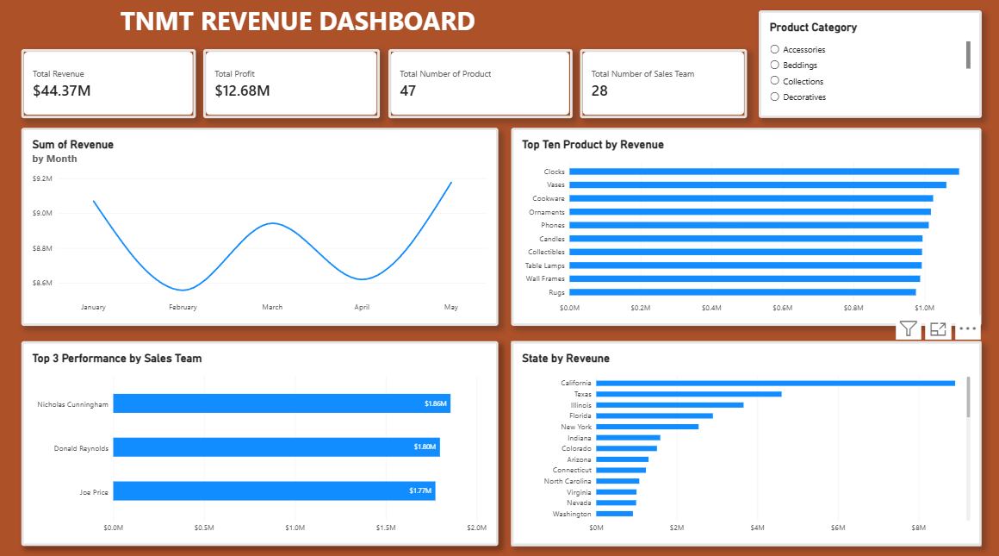

# TNMT Revenue Dashboard | Power BI

An interactive Power BI dashboard designed to provide a clear overview of TNMT's revenue performance, profitability, product contribution, and sales team results.

The dashboard brings key business metrics together in one place, helping stakeholders monitor performance, identify revenue drivers, and explore results across product categories, months, sales representatives, and states.

## Dashboard Preview



## Project Overview

This project focuses on analysing sales and revenue performance through an interactive business intelligence dashboard. It transforms sales data into an accessible visual report, making it easier to understand how the business is performing and where revenue is coming from.

## Key Performance Indicators

The dashboard highlights four headline metrics:

| KPI | Dashboard Result |
|---|---:|
| Total Revenue | **$44.37M** |
| Total Profit | **$12.68M** |
| Total Number of Products | **47** |
| Total Number of Sales Team Members | **28** |

## Dashboard Features

- **Revenue trend by month:** Tracks monthly revenue from January to May and makes changes in performance easy to identify.
- **Top 10 products by revenue:** Ranks the ten highest-revenue products to show which products contribute most to sales.
- **Top 3 sales team performance:** Compares the three leading sales team members by revenue.
- **Revenue by state:** Shows how revenue is distributed geographically and highlights stronger-performing states.
- **Product category slicer:** Allows users to filter the report by product category and explore the figures from different perspectives.
- **KPI cards:** Presents the most important business metrics at a glance.

## Key Takeaways from the Dashboard

Based on the figures and visuals displayed:

- TNMT recorded **$44.37M in total revenue** and **$12.68M in total profit**.
- The business has **47 products** represented in the report and a **28-member sales team**.
- Revenue varies across the five months shown, with May recording the highest monthly revenue in the displayed period.
- The top-product visual makes it possible to compare leading products and identify major revenue contributors.
- The sales team visual highlights the three highest revenue-generating team members.
- The state-level breakdown supports comparison of geographic sales performance.

## Tools & Skills Demonstrated

- **Microsoft Power BI** — report development and interactive data visualisation.
- **Business intelligence** — translating business data into decision-support insights.
- **Data analysis** — examining revenue, profit, product, team, and geographic performance.
- **Dashboard design** — organising KPIs and charts into a single, easy-to-navigate report.
- **Interactive reporting** — using a product-category slicer to explore the data.

## How to Use

1. Open the Power BI report file (`.pbix`) in Microsoft Power BI Desktop.
2. Use the **Product Category** slicer in the top-right corner to filter the report.
3. Explore the monthly revenue trend, top products, leading sales team members, and revenue by state.
4. Select or clear categories to compare performance across the available product groups.

> **Note:** The `.pbix` file and source dataset should be added to this repository separately if you want visitors to interact with the report and reproduce the analysis. This repository preview includes the dashboard image.

## Repository Structure

```text
TNMT-Revenue-Dashboard/
├── README.md
└── images/
    └── tnmt-revenue-dashboard.png
```

## About This Project

This dashboard is a demonstration of my ability to turn business data into meaningful visual insights using Power BI. I focused on presenting important performance indicators clearly while giving users the flexibility to explore the data through interactive filtering.

**Feedback and professional connections are welcome.**

---

*Project: TNMT Revenue Dashboard*  
*Tool: Microsoft Power BI*
